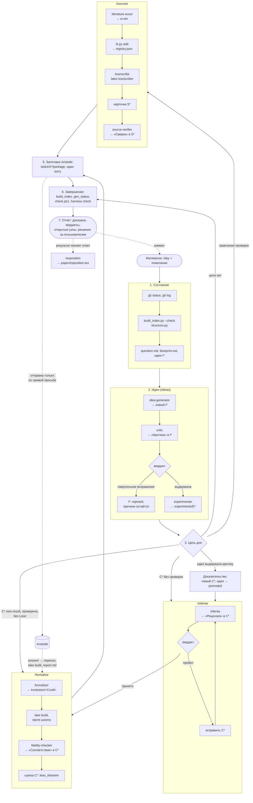
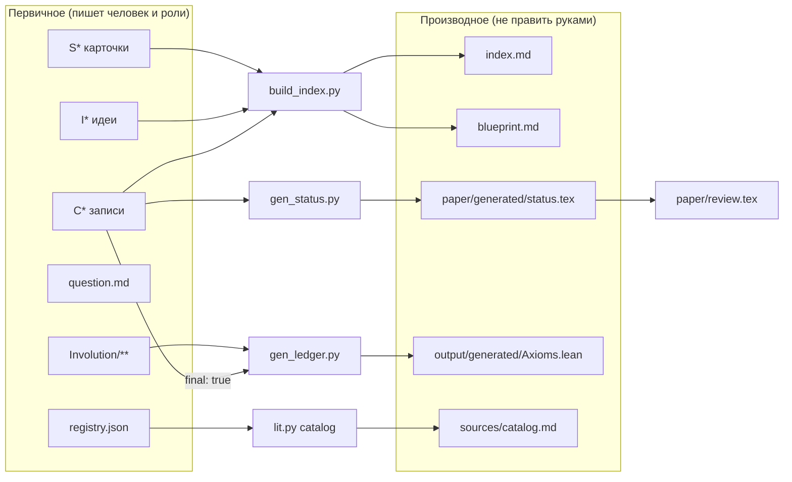
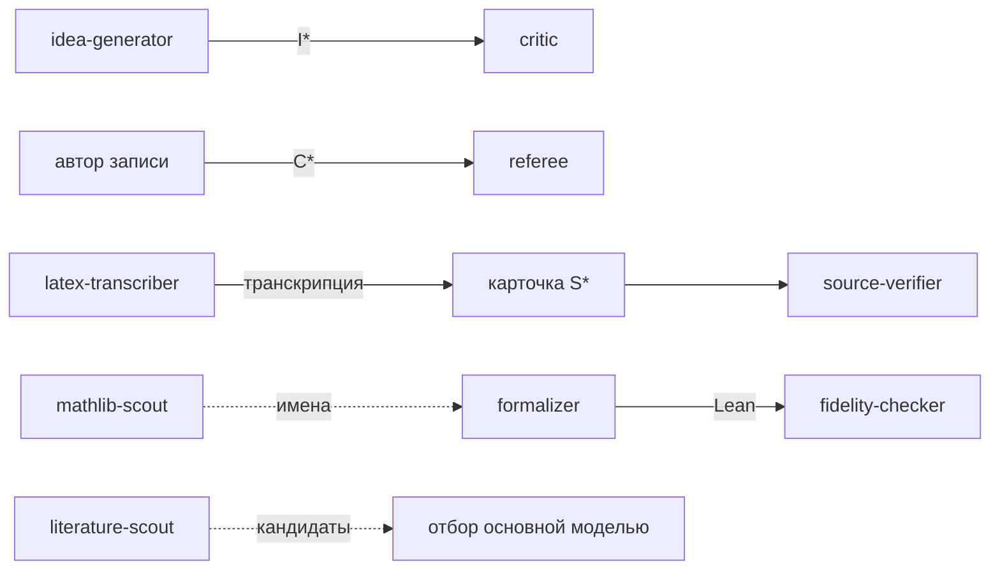

# Работа математика с проектом

Команды, роли и файлы, куда каждая из них пишет. Порядок шагов задают `.claude/commands/`,
права ролей — `.claude/agents/`, пути классов — `LAYOUT.md`; при расхождении со схемой
первичны они.

## Ежедневный цикл `/day`

## Откуда берутся сводки

Состояние единицы хранится только в шапке её файла; остальное собирают инструменты.

## Кто кого проверяет

Роль не проверяет свою работу; проверяющий получает текст без рассуждений автора.

