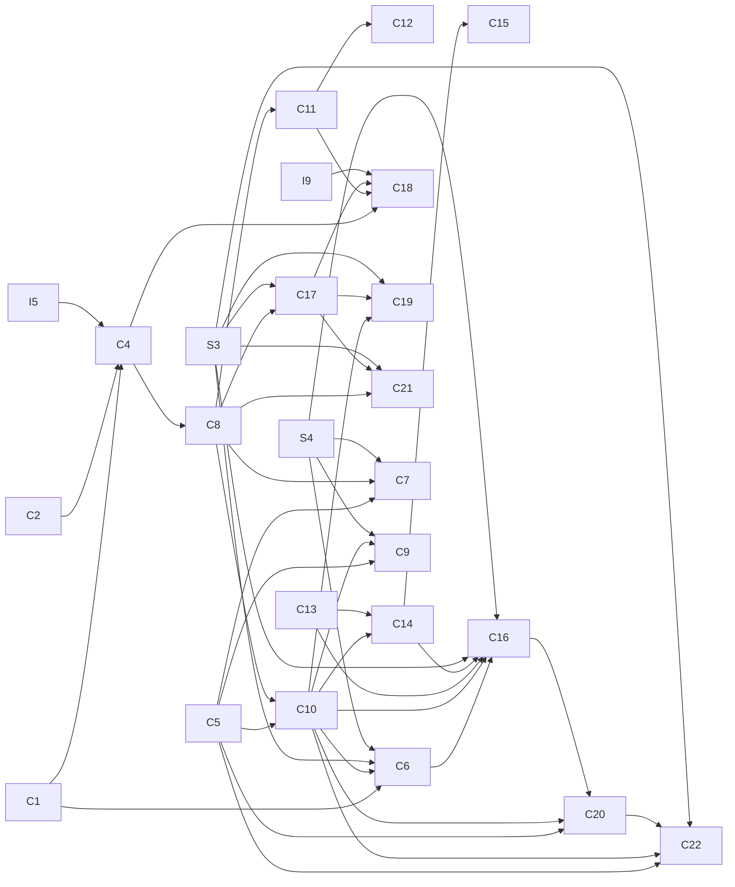

<!-- generated by tools/state/build_index.py; do not edit -->

# План формализации

Постановка: Q — Спектральная задача с отражением аргумента (`claims/question.md`).

## Узлы и зависимости

Узлов: 67, связей `depends_on`: 46. Граф ацикличен.

| id | title | status | depends_on | класс |
| --- | --- | --- | --- | --- |
| C1 | Сведение к двум компонентам | proved-lean | — | record |
| C2 | Обратимость главной матрицы | proved-lean | — | record |
| C3 | Постоянный коэффициент | proved-aristotle | — | record |
| C4 | Пример $a(x)=x/2$ | proved-lean | C1, C2, I5 | record |
| C5 | Чётный коэффициент: базис Рисса | proved-aristotle | — | record |
| C6 | Гладкий коэффициент постоянного знака: базис со скобками | proved-aristotle | C1, C10, S3, S4 | record |
| C7 | Когда скобки можно снять | proved-aristotle | C5, C8, S4 | record |
| C8 | Весь класс постановки: факторизация и компактный обратный | proved-lean | C4 | record |
| C9 | Когда главный множитель симметричен | proved-lean | C5, C10, S4 | record |
| C10 | Калибровка на всём интервале | proved-lean | C5, C8 | record |
| C11 | Пример без базисности: односторонний коэффициент | proved-lean | C8 | record |
| C12 | Пример в классе $W^1_\infty$: $a(x)=\max(x,0)$ | proved-lean | C11 | record |
| C13 | Малые возмущения порядка $1/2$: метод подобных операторов | proved-aristotle | — | record |
| C14 | Знакопостоянный коэффициент с малой производной | proved-lean | C10, C13 | record |
| C15 | Коэффициент, близкий к чётному | proved-aristotle | C14 | record |
| C16 | Общий знакопостоянный случай | proved-aristotle | C6, C10, C13, C14, S3, S4 | record |
| C17 | Сектор собственных значений и полнота | proved-lean | C8, S3 | record |
| C18 | Пример $a(x)=x/2$: нет базиса Рисса из собственных функций | proved-aristotle | C4, C11, C17, I9 | record |
| C19 | Калибровка нечётной фазой: полнота для всего класса постановки | proved-lean | C10, C17, S3 | record |
| C20 | Положительное гладкое отношение $a(x)/a(-x)$: базис Рисса со скобками для знакопеременного коэффициента | proved-lean | C5, C10, C16 | record |
| C21 | Оценка резольвенты вне сектора и суммируемость по Абелю–Лидскому | proved-lean | C8, C17, S3 | record |
| C22 | Положительное отношение $a(x)/a(-x)$ класса $W^1_\infty$: базис Рисса со скобками через возмущение формы | proved-lean | C5, C10, C20, S3 | record |
| I1 | $H_0^1$ как замыкание пробных функций | promoted | — | idea |
| I2 | Равномерные константы в блоках C16 | open | — | idea |
| I3 | Собственные значения главной матрицы при нулях $a$ | open | — | idea |
| I4 | Оценка длины блоков | open | — | idea |
| I5 | Нечётный коэффициент: унитарная эквивалентность умножению на $1+ia$ | open | — | idea |
| I6 | Две серии и блоки размерности не выше двух | open | — | idea |
| I7 | При $a=x/2$ нет базиса Рисса из собственных функций | promoted | — | idea |
| I8 | Сектор собственных значений и полнота | promoted | — | idea |
| I9 | Отрицательное произведение исключает базис Рисса из собственных функций | open | — | idea |
| I10 | Ограниченные блоки из локальной счётной функции | open | — | idea |
| I11 | Симметризатор $1/\lvert a\rvert$ (отвергнута) | rejected | — | idea |
| I12 | Ограниченные скобки по теореме 7.1: количественная отделённость двух серий при фиксированном расстоянии номеров | rejected | — | idea |
| I13 | Весовое условие Шура на недиагональные элементы вместо отделённости номеров | rejected | — | idea |
| I14 | Точное действие $L_a$ на $\sin(m\pi x)$ при $a=x/2$: базис $\sin$ не диагонализует $L_a$ | open | — | idea |
| I15 | Сопряжённый к $T_aH$: критерий симметричности и граничный механизм | open | — | idea |
| I16 | При $a=x/2$ нет базиса Рисса со скобками ограниченной длины: точные квазимоды Макдональда и оценка резольвенты блока через определитель | open | — | idea |
| I17 | Калибровка нечётной фазой: полнота для всего класса постановки | promoted | — | idea |
| I18 | При $a=x/2$ частичные спектральные проекторы растут экспоненциально: нет базиса со скобками из подряд идущих собственных значений при любом размере скобок | open | — | idea |
| I19 | При $a=x/2$ задача изоспектральна задаче Дирихле с ограниченным аналитическим потенциалом на отрезке $[0,\ell]$: простота и асимптотика собственных значений | promoted | — | idea |
| I20 | Норма спектрального проектора через индефинитную форму $\langle RHy,z\rangle$: критерий снятия скобок | open | — | idea |
| I21 | Семейство $a_t=1/2+tx$: точки ветвления плотны, и при типичном $t$ скобки снять нельзя | open | — | idea |
| I22 | Знакопостоянный коэффициент — доминантный оператор с явным спектром и линеаризация в энергетическом пространстве; скобки ограниченного размера по теореме 7.1 обзора S3 при порядке 1 | open | — | idea |
| I23 | Отрицательное произведение — доминантный оператор с комплексной фазой Лиувилля не подобен нормальному; взамен базис для суммирования Абеля–Лидского порядка больше 1/2 | open | — | idea |
| I24 | Характеристический определитель модели I22 равен cos(μℓ₊)sin(μℓ₋); плотность и порядок α=1, диофантова дихотомия для зазоров, закрытие шага 4 I22 и регулярность в смысле S8/S35 | rejected | — | idea |
| I25 | Явная граница размера блоков из точной арифметики модели по частотной переменной и перенос на класс C16 через запас возмущения | rejected | — | idea |
| I26 | Смена знака произведения $a(x)a(-x)$ исключает базис Рисса из собственных функций — аналог невещественной фазы S35 для гладкого $a$ без нечётности | open | — | idea |
| I27 | Знакопеременный коэффициент с положительным гладким отношением $a(x)/a(-x)$ — калибровка к чётному и базис со скобками C16 без условия $\lvert a\rvert\ge m$ | promoted | — | idea |
| I28 | Размер скобок C16 через шаг разрезов и счёт нулей оконного определителя | open | — | idea |
| I29 | Двучленное ВКБ-разложение для сложенной системы 2×2 — лемма шага 4 идеи I26 с остатком O(1) и гладкостью C^3 | open | — | idea |
| I30 | Возмущение квадратичной формой — базис Рисса со скобками C20 при $q\in W^1_\infty$ вместо $W^2_\infty$; знакопостоянный $a$ класса постановки | promoted | — | idea |
| I31 | Целесообразность подхода через формы — что он даёт сверх C16, C19, C20 и где ломается схема черновика D | open | — | idea |
| I32 | Регулярность в смысле Шкаликова для условий Штурма — главная часть характеристического определителя синус-типа ширины ℓ₊+ℓ₋; классификация трёх случаев разделённых условий | open | — | idea |
| I33 | Смешанные условия (Дирихле на одном конце, β≠0 на другом) строго регулярны — нули Δ₀ перемежаются с сеткой πk/L и отделены; кандидат в базис Рисса без чётности a | open | — | idea |
| I34 | Общие двухточечные условия — регулярность через коэффициенты K₁…K₄ при μ²S₊C₋, μS₊S₋, μC₊C₋, C₊S₋, выраженные через миноры J_{ij} | open | — | idea |
| I35 | Схема C22 для условий Штурма и общих условий робеновского типа — граничный член формы не зависит от веса $r$ | open | — | idea |
| I36 | Схема C22 для условий, связывающих значения $y(1)=c\,y(-1)$ (периодические, антипериодические) — проходит при $c=0$ или $a(1)=a(-1)$, иначе формы на разных пространствах | open | — | idea |
| S1 | Bondarenko, матричная редукция (прочитанная часть) | unverified-source | — | card |
| S2 | Постоянная модель с отражением | unverified-source | — | card |
| S3 | Обзор теории подчинённых возмущений | verified | — | card |
| S4 | Подчинённые возмущения нормальных операторов | unverified-source | — | card |
| S5 | Отражение старшей производной порядка выше двух | unverified-source | — | card |
| S6 | Sarsenbi, Symmetry 13(10), 1972 (2021) | unverified-source | — | card |
| S8 | Регулярность и строгая регулярность | unverified-source | — | card |
| S43 | Асимптотика собственных значений при комплексном потенциале | verified | — | card |
| S47 | Локализация спектра Дирихле при комплексном потенциале | verified | — | card |

## Слои библиотеки

| Слой | Модули |
| --- | --- |
| Setup | `ACDomain.lean`, `ClassicalModes.lean`, `ComplexAC.lean`, `DirichletDomain.lean`, `DirichletEnergy.lean`, `IntervalOperator.lean`, `IntervalRegularity.lean`, `IntervalSobolev.lean`, `IntervalTrace.lean`, `L2Parity.lean`, `L2Reflection.lean`, `PhaseSelection.lean`, `Reflection.lean`, `SmoothPrimitive.lean`, `WeakConstant.lean`, `WeakDerivative.lean`, `WeakPrimitive.lean` |
| Folding | `ComplexReduction.lean`, `FoldedOperator.lean`, `FoldedSobolev.lean`, `FoldingIntegral.lean`, `IntervalGluing.lean`, `IntervalReflection.lean`, `L2Folding.lean`, `Reduction.lean`, `Symmetrization.lean`, `VariableOperator.lean` |
| Model | `ACSpectral.lean`, `BlockInvariant.lean`, `BlockMultiplier.lean`, `BlockPerturbation.lean`, `BracketBounds.lean`, `CoefficientInverse.lean`, `CoefficientSqrt.lean`, `CompactEigenbasis.lean`, `CompactInverse.lean`, `DirichletGreen.lean`, `EigenvalueCounting.lean`, `EvenCoefficient.lean`, `EvenEigenbasis.lean`, `EvenNoJordan.lean`, `FiniteSynthesis.lean`, `FlattenedBounds.lean`, `GaugeOperators.lean`, `GaugeSimilarity.lean`, `ModelBasis.lean`, `ModelEigenbasis.lean`, `MultiplicationEquiv.lean`, `ParityBasis.lean`, `ParityDomain.lean`, `ParityGreen.lean`, `ParityMultiplier.lean`, `PositiveWeight.lean`, `RieszBasis.lean`, `ScalarDomain.lean`, `SchurMultiplier.lean`, `SobolevModes.lean`, `SobolevMultiplier.lean`, `SparseCuts.lean`, `SpectralGreen.lean`, `SubordinatePerturbation.lean`, `WeightedEigenbasis.lean`, `WeightedGreen.lean`, `WeightedSymmetry.lean` |
| Estimates | `BracketCorollaries.lean`, `EigenvalueSector.lean`, `FormEnergy.lean`, `FormMarkusMatsaev.lean`, `FormRatioBrackets.lean`, `GaugeResolvent.lean`, `GeneralBrackets.lean`, `HalfSlope.lean`, `HalfSlopeProfile.lean`, `MMCompact.lean`, `MMContour.lean`, `MMCore.lean`, `MMCuts.lean`, `MMEstimates.lean`, `MMGoodCut.lean`, `MMMinModulus.lean`, `MMOperators.lean`, `MMPointwise.lean`, `MMRiesz.lean`, `MMRieszBasis.lean`, `MMScalar.lean`, `MMSideInt.lean`, `MMTotal.lean`, `MMWindow.lean`, `MMWindowCut.lean`, `MMWoodbury.lean`, `MarkusMatsaev.lean`, `NearlyEvenBrackets.lean`, `OddCoefficient.lean`, `OneSidedExample.lean`, `PositiveRatioBrackets.lean`, `ProjectionBrackets.lean`, `RampNoBasis.lean`, `RampSpectrum.lean`, `RayResolvent.lean`, `ResolventAux.lean`, `ResolventBound.lean`, `RieszEigenCount.lean`, `SignDefiniteBrackets.lean`, `SobolevClosure.lean` |
| Theorems | `BasisConditions.lean`, `MainTheorems.lean` |
| Examples | `Examples.lean`, `MatrixInverse.lean` |

Все модули лежат в каталогах слоёв.

## Задачи внешнему исполнителю

| id | title | status | goal | date |
| --- | --- | --- | --- | --- |
| A1 | Постоянство при нулевой слабой производной | accepted | C1 | 2026-10-10 |
| A2 | Ортонормированность и полнота модельной системы | accepted | C3 | 2026-10-10 |
| A3 | Диагональные операторы и мультипликаторы Шура | accepted | C13 | 2026-10-10 |
| A4 | Упражнение для Aristotle: редукция системы 2×2 (узел A4) | open | Q | 2026-10-10 |
| A5 | Три леммы метода подобных операторов | accepted | C13 | 2026-10-10 |
| A6 | Калибровочные данные близкого к чётному коэффициента | accepted | C15 | 2026-10-10 |
| A7 | Теорема Маркуса–Мацаева при p = 1/2 (диагональная форма) | accepted | C16 | 2026-10-10 |
| A8 | Слабая область Дирихле равна H² ∩ H₀¹ (узел S-DOMAIN) | accepted | Q | 2026-10-10 |
| A9 | При a = x/2 нет базиса Рисса из собственных функций (узел S-GENERAL) | accepted | C18 | 2026-10-11 |
| A10 | Обратимость T_a и оценка резольвенты (утверждение 2 записи C17) | accepted | C17 | 2026-10-12 |
| A11 | Выбор гладкой нечётной фазы (утверждение 3 записи C19) | accepted | C19 | 2026-10-13 |
| A12 | Миниобзор: запрос по снимку заметок | open | Q | 2026-10-10 |

## Опись источников

Опись: `sources/registry.json`.

* Кодов: 47 (уникальных: 47).
* С полным текстом локально (`output/literature/`): 41.
* Полного текста нет: 6 — S36, S37, S38, S40, S41, S42.

## Замечания

Замечаний нет.
