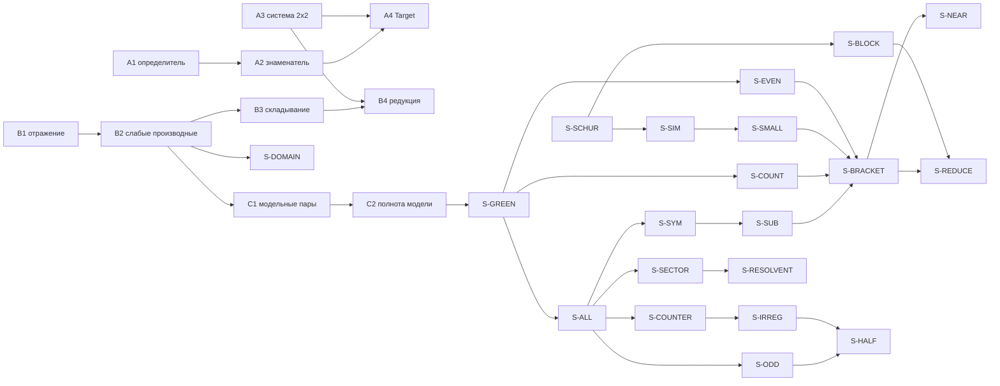

# Карта формализации

Записи C5–C16, C18 и утверждения 1–2 записи C17 (`context.md`) доказаны в Lean на
слабой области Дирихле; она равна $H^2\cap H_0^1$ (S-DOMAIN). Открыты два узла: S-SPLIT
для блоков C16 и S-GENERAL. Версии: Lean `v4.35.0-rc4`, Mathlib
`1f414401f69059aa7eead47b53ee40bd38455eeb`. Аксиомы итоговых теорем проверяются в
`Scratch.lean`: `propext`, `Classical.choice`, `Quot.sound`.

## Узлы

Алгебра и редукция.

| Узел | Утверждение | Зависимости | Lean |
| --- | --- | --- | --- |
| A1 | $\det M=1-ab$ | `Matrix.det_fin_two` | `principalMatrix_det` |
| A2 | $1-ab\ge1-\kappa>0$ | A1, `le_abs_self` | `determinant_lower_bound`, `determinant_pos` |
| A3 | решение системы $2\times2$ и обратная матрица над полем | $1-ab\ne0$, `eq_div_iff` | `solve_system`, `principalMatrix_inv` |
| A4 | редукция при $\lvert ab\rvert\le\kappa<1$ над $\mathbb R$ | A2, A3 | `reduction_under_product_bound` в `Target.lean` |
| A5 | постоянная матрица в координатах суммы и разности | — | `constant_diagonalization` |
| A6 | пример $a=x/2$: $\det M\ge1$, $\lvert a(x)a(-x)\rvert\le1/4$ | — | `odd_coefficient_product_bound`, `odd_coefficient_determinant_ge_one` |
| A7 | комплексная редукция при вещественных $a$, $b$ | A2, A3 | `ComplexReduction.lean` |
| B1 | отражение $R$, $R^2=I$, чётная и нечётная части в $L_2$ | сохранение меры | `Reflection.lean`, `L2Reflection.lean`, `L2Parity.lean` |
| B2 | слабые производные, регулярные представители, следы, склейка | B1 | `MemIntervalH2.exists_regular_pair`, `memIntervalH2_intervalJoin`, `memDirichletH2_reflectedJoin` |
| B3 | унитарное складывание и эквивалентность областей | B2 | `l2FoldingEquiv`, `memDirichletH2_iff_fold` |
| B4 | редукция оператора с коэффициентом из $L_\infty$ | A3, B3 | `variableSobolevOperator_unitary_reduction` |
| C1 | собственные пары при постоянном $a$ | A5, B2 | `constant_cosine_eigenpair`, `constant_sine_eigenpair` |
| C2 | ортонормированность и полнота модели | C1, равенство Парсеваля | `constantModel_orthonormal`, `constantModel_dense_span` |
| D1 | алгебра симметризации главной матрицы | A1 | `Symmetrization.lean`; итоговые теоремы её не используют |
| D2 | перенос базиса ограниченным обратимым оператором | `HilbertBasis` | `RieszBasis.lean` |

Спектральные узлы.

| Узел | Утверждение | Зависимости | Lean |
| --- | --- | --- | --- |
| S-GREEN | обратный оператор Дирихле $G$: ряд ранга один, компактность, симметричность | B2, C2 | `SpectralGreen.lean`, `ParityGreen.lean` |
| S-ALL | C8: $L_a=(I+aR)(-D^2)$, компактный обратный, альтернатива Фредгольма | S-GREEN | `productBound_compact_inverse`, `productBound_fredholm` |
| S-CRIT | C9: $I+aR$ симметричен $\iff$ $a$ чётна | S-ALL | `principalOperator_isSymmetric_iff` |
| S-EVEN | C5: чётный $a$, базис Рисса, цепочек нет | S-GREEN, D2 | `evenCoefficient_riesz_eigenbasis`, `evenCoefficient_noJordan` |
| S-COUNTER | C11: $a=4\cdot\mathbf 1_{(0,1)}$, собственных значений нет | S-ALL, лемма Гронуолла | `oneSided_no_eigenfunction`, `oneSided_no_bracket_basis` |
| S-IRREG | C12: $a=\max(x,0)$, нет базиса Рисса из собственных функций | S-COUNTER | `ramp_eigenvalue_bound`, `ramp_quasimodes`, `ramp_no_riesz_eigenbasis` |
| S-SYM | C10: калибровка $L_a(rf)=r(L_bf+Bf)$ с чётным $b$ | S-ALL, правило произведения $W^2_\infty\times H^2$ | `gauge_similarity`, `signDefinite_gauge_reduction` |
| S-SUB | C10: подчинённость с показателем $1/2$ | S-SYM | `gaugePerturbation_subordinate` |
| S-SCHUR | диагональные операторы и мультипликаторы Шура | ряды Неймана | `SchurBound.blockSum`, `offMult_bound` |
| S-SIM | метод подобных операторов на разреженных блоках | S-SCHUR, сжимающие отображения | `exists_block_similarity`, `exists_bracket_basis` |
| S-SMALL | C13: малое возмущение порядка $1/2$ | S-SIM | `exists_bracket_basis_of_subordinate` |
| S-COUNT | счётная функция $W G W$ без минимакса: $N(t)\le(2\nu/\pi)t+2$ | S-GREEN, S-SCHUR | `green_sandwich_eigen_count` |
| S-BRACKET | C14: знакопостоянный $a$ с малой $a'$ | S-SYM, S-SUB, S-COUNT, S-SMALL, S-EVEN | `bracket_basis_of_gauge`, `signDefinite_bracket_basis` |
| S-NEAR | C15: близость к чётному | S-BRACKET | `nearlyEven_bracket_basis` |
| S-BLOCK | теорема Маркуса–Мацаева при $p=1/2$, диагональная форма | S-SCHUR; S4, теорема 6.1 | `exists_bracket_basis_of_subordinate_general` |
| S-REDUCE | C16: C6 без малости | `bracket_basis_of_gauge_core`, S-BLOCK | `signDefinite_bracket_basis_W2` |
| S-SPLIT | C7: критерий снятия скобок | D2 | `exists_rieszBasis_iff_uniformBlockBounds`; для блоков C16 равномерные константы не проверены |
| S-DOMAIN | слабая область Дирихле равна $H^2\cap H_0^1$, где $H_0^1$ — замыкание пробных функций по норме $H^1$ | B2 | `memIntervalH01_iff_trace`, `memDirichletH2_iff_h2_and_h01`; описание через абсолютно непрерывные функции — `memDirichletH2_iff_acRealization` |
| S-ODD | нечётный $a\in L_\infty$: $UL_a=(1+ia)(-D^2)U$ с унитарным $U=P_++iP_-$ | B1, S-ALL | `parityRotation_norm`, `oddCoefficient_unitary_multiplication`, `oddCoefficient_eigen_iff` |
| S-SECTOR | C17: при $\lvert a(x)+a(-x)\rvert\le2\alpha$, $\alpha<1$, $\lvert a(x)-a(-x)\rvert\le2\beta$ собственные значения лежат в секторе $(1-\alpha)\lvert\operatorname{Im}\lambda\rvert\le\beta\operatorname{Re}\lambda$ | S-ALL, энергетическое тождество | `eigenvalue_sector`, `oddCoefficient_eigenvalue_sector`, `ramp_eigenvalue_sector` |
| S-RESOLVENT | C17, утверждение 2: $T_a$ обратим при $\lvert a(x)+a(-x)\rvert\le2\alpha$, $\alpha<1$; $(L_a+s)f=h$ однозначно разрешимо при $s\ge0$, $\lVert f\rVert\le\lVert G\rVert\lVert h\rVert/(1-\alpha)$ и $\lVert f\rVert\le\lVert T_a\rVert^2\lVert h\rVert/((1-\alpha)^2s)$ | S-SECTOR, S-GREEN | `principalOperator_boundedInverse`, `resolvent_estimate_corrected`, `resolvent_ray_estimate`; полнота (S3, теорема 4.7) не формализована |
| S-HALF | C18: при $a=x/2$ нет базиса Рисса из собственных функций | S-ODD, S-IRREG, S-COUNT | `halfSlope_quasimodes`, `rieszEigenbasis_count`, `halfSlope_no_riesz_eigenbasis` |
| S-GENERAL | весь класс $W^1_\infty$: нули и смена знака | S-ODD для нечётного $a$, S-SECTOR, S-HALF | открыт; базис со скобками и базис с присоединёнными функциями для нечётного $a$ не исследованы |

## Модули

Все модули, кроме отмеченных в последнем столбце, доказаны локально.

| Группа | Модули `Involution/` | От Aristotle |
| --- | --- | --- |
| Алгебра | `Reduction`, `MatrixInverse`, `ComplexReduction`, `Examples`, `Symmetrization` | — |
| Отражение в $L_2$ | `Reflection`, `L2Reflection`, `L2Parity`, `FoldingIntegral` | — |
| Слабые производные | `WeakDerivative`, `SmoothPrimitive`, `WeakConstant`, `WeakPrimitive`, `ComplexAC` | `WeakConstant` |
| $H^2$ на интервале | `IntervalSobolev`, `IntervalTrace`, `IntervalRegularity`, `IntervalGluing`, `IntervalReflection`, `IntervalOperator`, `ACDomain`, `SobolevClosure` | `SobolevClosure` |
| Складывание | `L2Folding`, `FoldedSobolev`, `VariableOperator`, `FoldedOperator` | — |
| Модель | `ClassicalModes`, `SobolevModes`, `ModelBasis`, `ModelEigenbasis` | `ModelBasis` |
| Оператор Дирихле | `DirichletDomain`, `ScalarDomain`, `DirichletEnergy`, `DirichletGreen`, `SpectralGreen`, `ParityGreen` | — |
| Чётный коэффициент | `WeightedGreen`, `PositiveWeight`, `CompactEigenbasis`, `MultiplicationEquiv`, `WeightedEigenbasis`, `EvenCoefficient`, `ParityBasis`, `ParityMultiplier`, `EvenEigenbasis`, `WeightedSymmetry`, `ParityDomain`, `EvenNoJordan`, `ACSpectral` | — |
| Базисы | `RieszBasis`, `BracketBounds`, `FlattenedBounds`, `FiniteSynthesis`, `ProjectionBrackets` | — |
| Весь класс и примеры | `CompactInverse`, `OneSidedExample`, `RampSpectrum`, `RampNoBasis`, `OddCoefficient`, `EigenvalueSector`, `ResolventAux`, `ResolventBound` | `ResolventAux`; в `ResolventBound` — `principalOperator_boundedInverse` |
| Пример $a=x/2$ | `HalfSlopeProfile`, `RieszEigenCount`, `HalfSlope` | все |
| Калибровка | `SobolevMultiplier`, `CoefficientInverse`, `CoefficientSqrt`, `GaugeSimilarity`, `GaugeOperators` | — |
| Метод подобных операторов | `SchurMultiplier`, `BlockMultiplier`, `SparseCuts`, `BlockPerturbation`, `BlockInvariant`, `SubordinatePerturbation`, `EigenvalueCounting` | `SchurMultiplier`, `SparseCuts` |
| Скобки для $L_a$ | `SignDefiniteBrackets`, `BracketCorollaries`, `NearlyEvenBrackets`, `GeneralBrackets` | лемма `nearlyEven_gauge_data` |
| Теорема Маркуса–Мацаева | `MarkusMatsaev`, `MMContour`, `MMRiesz`, `MMOperators`, `MMCompact`, `MMCuts`, `MMScalar`, `MMSideInt`, `MMPointwise`, `MMEstimates`, `MMTotal`, `MMRieszBasis`, `MMWoodbury`, `MMWindow`, `MMMinModulus`, `MMWindowCut`, `MMGoodCut`, `MMCore` | все |
| Сводки | `MainTheorems`, `BasisConditions` | — |

`ProjectionBrackets` содержит критерий S4, предложение 3.7, в знаковой форме
(`projection_riesz_bounds`); в цепочке C16 используется его аналог из `MMRieszBasis`.

## Задачи Aristotle

Задачи 1–7 отправлены 10.10.2026; ответ 7 принят 11.10.2026; задача 8 отправлена
11.10.2026, задача 9 — 12.10.2026; ответы 8 и 9 приняты 12.10.2026. Для каждого принятого ответа сверены формулировки с отправленной заготовкой, проверено отсутствие `sorry` и `axiom`,
модуль собран локально с закреплёнными версиями. Архивы и квитанции лежат в `output/`.

| № | Проект | Задача | Архив | Принято |
| --- | --- | --- | --- | --- |
| 1 | `94018f4e-bbff-42ca-b92b-d4529070e91a` | постоянство при нулевой слабой производной | `aristotle-weak-result.tar.gz` | `WeakConstant.lean`, `HasWeakDerivOn.ae_eq_const_of_zero` |
| 2 | `94d172f6-5648-4b7e-859a-b69130301e10` | ортонормированность и полнота модели C3 | `aristotle-model-result.tar.gz` | `ModelBasis.lean` |
| 3 | `d1c6ea68-aea5-4e0f-ae40-fd4a5cf66d60` | мультипликаторы Шура, 20 утверждений | `aristotle-schur-result.tar.gz` | `SchurMultiplier.lean` |
| 4 | `62ba5391-5d03-4a3d-b1e5-9949583b2639` | `exists_similarity_fixedPoint`, `exists_sparse_cuts`, `card_le_of_finiteRank_approx` | `aristotle-cuts-result.tar.gz` | `SparseCuts.lean` |
| 5 | `7f253d14-9ab7-4b6c-a64c-d8814d2e70f6` | `nearlyEven_gauge_data` | `aristotle-nearly-even-result.tar.gz` | `NearlyEvenBrackets.lean` |
| 6 | `c4fdbf81-6fdc-48c0-b18a-995935371d25` | `exists_bracket_basis_of_subordinate_general` по статье S4 | `aristotle-markus-result.tar.gz`, `aristotle-markus-result2.tar.gz` | `MarkusMatsaev.lean` и 17 модулей `MM*` |
| 7 | `18ff2d66-76b1-4b36-9808-c9e2df6825f5` | узел S-DOMAIN: `memIntervalH01_iff_trace`, `memDirichletH2_iff_h2_and_h01` | `aristotle-domain-result.tar.gz` | `SobolevClosure.lean` |
| 8 | `55948b6e-fdd9-40a9-a773-134c314d2281` | узел S-GENERAL: `halfSlope_no_riesz_eigenbasis` — при $a=x/2$ нет базиса Рисса из собственных функций | `aristotle-halfslope-result.tar.gz` | `HalfSlopeProfile.lean`, `RieszEigenCount.lean`, `HalfSlope.lean` |
| 9 | `4fa6750a-179c-4643-a25c-4fd9f13cfe54` | C17, утверждение 2: `reflectedMultiplier_re_inner_bound`, `principalOperator_boundedInverse`, `resolvent_estimate` | `aristotle-resolvent-result.tar.gz` | частично: `ResolventAux.lean`, `principalOperator_boundedInverse`; две формулировки заготовки опровергнуты |

Задача 7 отправлена пакетом `output/aristotle-open-nodes`: весь проект и заготовка
`Involution/SobolevClosure.lean` с определениями `IsTestPair`, `MemIntervalH01` и двумя
`sorry`. Пространство $H_0^1(-1,1)$ в заготовке — замыкание гладких функций с носителем
в $(-1,1)$ по норме $H^1$. В ответе из 99 отправленных файлов изменён один,
`SobolevClosure.lean`: определения и заголовки двух теорем совпадают с заготовкой,
добавлены импорт `Involution.ComplexAC` и десять вспомогательных объявлений. Доказательство
идёт через $K^{\perp\perp}=\overline K$ для подпространства пробных пар, а не по наброску
из `prompt.md`. Определения `IsTestPair` и `MemIntervalH01` приняты 11.10.2026. Узлы S-SPLIT для блоков C16 и S-GENERAL не отправлялись: для них нет
формулировки, которую можно дать как цель в Lean.

Задача 6 исчерпала лимит времени с одной недоказанной леммой `MMData.exists_cuts`;
команда `aristotle continue` её закрыла (второй архив). В модулях `MM*` после переноса
локально правился только стиль: устаревшие имена лемм, длинные строки, три вызова `simp`
заменены на `simp only`. Формулировки не менялись.

Задача 8 отправлена пакетом `output/aristotle-halfslope`: весь проект и заготовка
`Involution/HalfSlope.lean` с определениями `halfSlopeCoefficient`, `halfSlopeClass` и
тремя `sorry` (`halfSlope_quasimodes`, `rieszEigenbasis_count`,
`halfSlope_no_riesz_eigenbasis`). Бумажный набросок — `ideas.md`, I7; формулировки двух
промежуточных лемм сервису разрешено менять, итоговую — нет. В ответе (статус
`COMPLETE`) определения и заголовки трёх теорем совпадают с заготовкой, `sorry` и `axiom`
нет; добавлены модули `HalfSlopeProfile.lean` и `RieszEigenCount.lean`, два импорта и
шесть вспомогательных объявлений в `HalfSlope.lean`. Файл `Target.lean`, добавленный
сервисом, не перенесён. Три модуля перенесены без правок.

Задача 9 отправлена 12.10.2026 пакетом `output/aristotle-resolvent`: весь проект и заготовка
`Involution/ResolventBound.lean` с тремя `sorry` (`reflectedMultiplier_re_inner_bound`,
`principalOperator_boundedInverse`, `resolvent_estimate`). Это утверждение 2 записи C17;
формулировки менять нельзя, в библиотеку заготовка не входит. Заготовка собрана локально
с закреплёнными версиями перед отправкой (три предупреждения `declaration uses sorry`).
Задача отправлена по прямому запросу пользователя; параллельная локальная формализация
остановлена, потому что шла слишком долго.

Ответ на задачу 9 пришёл со статусом `COMPLETE_WITH_ERRORS`. Доказана
`principalOperator_boundedInverse`. Две другие формулировки заготовки ложны, и сервис
доказал их отрицания в `ResolventCounter.lean`: в `reflectedMultiplier_re_inner_bound`
пропущена вещественность коэффициента (ошибка заготовки; контрпример
$A=i\operatorname{sign}x$), а оценка $\lVert G\rVert/(s+1-\alpha)$ в `resolvent_estimate`
неверна уже при $a=0$ (ошибка записи C17, исправлена 12.10.2026). В библиотеку
перенесены `ResolventAux.lean` без правок и теорема `principalOperator_boundedInverse`;
`ResolventCounter.lean` и версия `ResolventBound.lean` с двумя `sorry` остались в архиве.
Теорема `resolvent_ray_estimate` в библиотечном `ResolventBound.lean` доказана локально.

`input-lean/Target.lean` — упражнение для сервиса: узел A4 с одним `sorry`. Корневой
`Target.lean` доказан локально.

## Опоры Mathlib

- Алгебра: `Matrix.det_fin_two`, `Matrix.inv_eq_right_inv`, `eq_div_iff`, `le_abs_self`.
- Абсолютная непрерывность:
  `IntervalIntegrable.absolutelyContinuousOnInterval_intervalIntegral`,
  `IntervalIntegrable.ae_hasDerivAt_integral`,
  `AbsolutelyContinuousOnInterval.integral_mul_deriv_eq_deriv_mul`.
- Полнота модели: `tsum_sq_fourierCoeffOn` для периода $4$ после нечётного продолжения
  относительно $x=1$. Базис `AddCircle.fourierBasis` напрямую не подходит: у него
  окружность с нормированной мерой Хаара.
- Умножение $L_\infty\times L_2\to L_2$: `Lp.coeFn_lpSMul`, `Lp.norm_smul_le`.
- Спектральная теория: `IsCompactOperator.hasEigenvalue_or_mem_resolventSet`,
  `Module.End.exists_eigenvalue`, `Module.End.iSup_maxGenEigenspace_eq_top`.
- Продолжение по плотности: `LinearEquiv.extend`.
- C11–C12: `norm_le_gronwallBound_of_norm_deriv_right_le`, `antitoneOn_of_deriv_nonpos`,
  `Real.smoothTransition`.
- C13: `ContractingWith.exists_fixedPoint'`, `LinearMap.ker_ne_bot_of_finrank_lt`,
  `Orthonormal.sum_inner_products_le`, `tsum_geometric_two`.

Имена проверяются в локальных исходниках Mathlib и в `Scratch.lean`.
